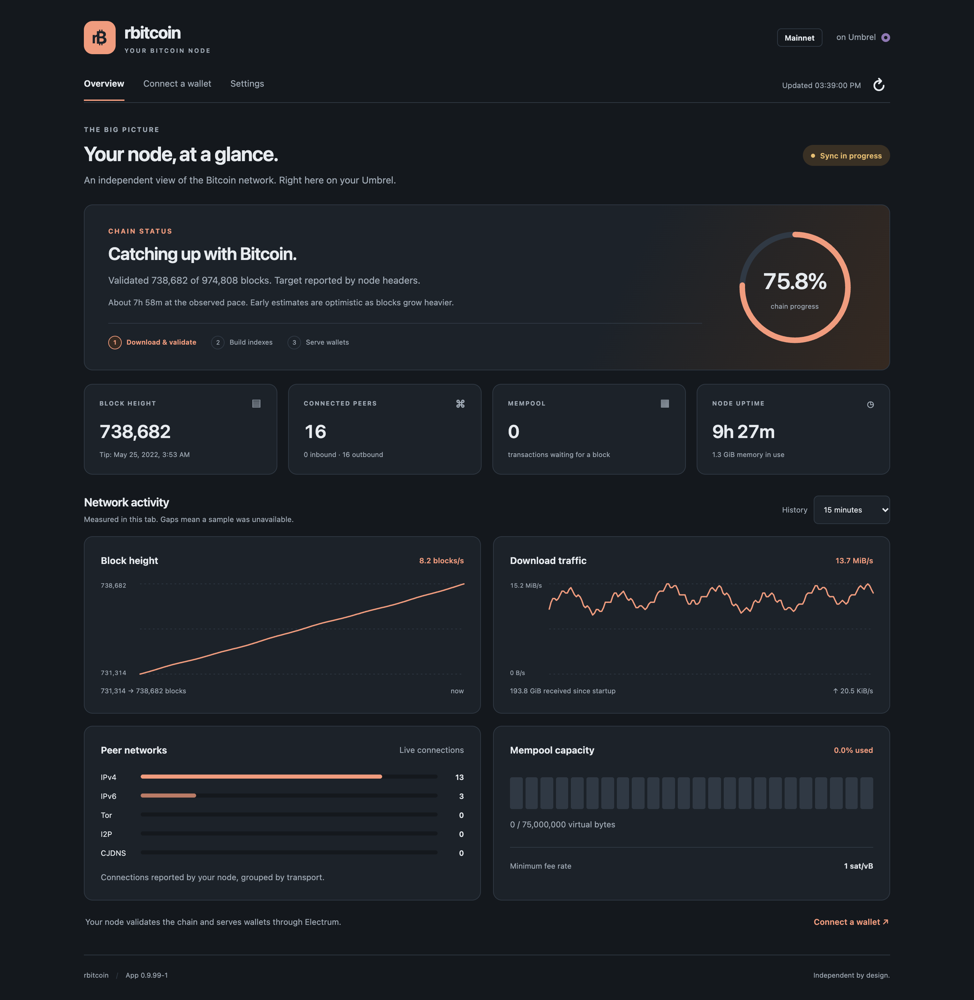

# rbitcoin for Umbrel

A [community app store](https://github.com/getumbrel/umbrel-community-app-store) for [Umbrel](https://umbrel.com) with one app: [rbitcoin](https://github.com/rbitcoin-org/rbitcoin), a Bitcoin full node written in Rust that downloads and validates the chain itself and serves the Electrum protocol from the same process. It needs no Bitcoin Core and no separate indexer. Install it to give your wallets, on this Umbrel and on your home network, an Electrum server that runs on your own box.

The app depends on no other app. [Beignet](https://github.com/coreyphillips/beignet-umbrel) has a one-click preset for it, and any Electrum wallet can use it.

<p align="center">
  
  
</p>
<p align="center"><sub>The app's dashboard on a synced node (light theme) and during the first sync (dark theme), rendered from <code>docker/web</code> with sample figures.</sub></p>

## Install on Umbrel

1. In umbrelOS, open the **App Store**, then **Community App Stores**.
2. Add this store by URL: `https://github.com/coreyphillips/rbitcoin-umbrel`
3. Read the next section, then install **rbitcoin** from the store.

## Moving from the Beignet store

Until app 0.8.99-2 this app lived in the [Beignet store](https://github.com/coreyphillips/beignet-umbrel) as `beignet-rbitcoin`. It now lives here as `rbitcoin-node`. Umbrel ties an app's id to its store, so this is a new app to umbrelOS, with its own data directory: installing it does not pick up the old app's chain. The old app keeps running if you leave it, but it gets no more updates.

The node and its on-disk store are the same, so you can move a synced chain over instead of syncing again. The new app reuses the old app's ports (2114 for the dashboard, 50011 for Electrum on your network), so only one of the two can run at a time, and wallets on your network keep their settings.

1. Stop the old **rbitcoin** app from its menu on the home screen. A clean stop flushes the store and can take up to 15 minutes; wait until umbrelOS shows it stopped.
2. Add this store and install **rbitcoin** from it. It starts a fresh sync; stop it from its menu as soon as it is running.
3. Open a terminal on the Umbrel (Settings, Advanced settings, Terminal, umbrelOS; or SSH) and move the chain and the saved settings across:

   ```sh
   sudo rm -rf ~/umbrel/app-data/rbitcoin-node/data ~/umbrel/app-data/rbitcoin-node/settings
   sudo mv ~/umbrel/app-data/beignet-rbitcoin/data ~/umbrel/app-data/rbitcoin-node/data
   sudo mv ~/umbrel/app-data/beignet-rbitcoin/settings ~/umbrel/app-data/rbitcoin-node/settings
   ```

4. Start the new **rbitcoin** app. Its dashboard shows the height the old app had reached, and it carries on from there.
5. Uninstall the old app. Its chain is no longer in its directory, so this frees nothing more than the app itself.
6. In Beignet, wallets that used the old app reach it at `beignet-rbitcoin_node_1`, which no longer answers. Open each one's **Edit** dialog and pick the **Umbrel rbitcoin** preset again (Beignet app 0.38.1 and later point it at this app), or enter `rbitcoin-node_node_1`, port 50001, no TLS. Wallets on other machines that use `umbrel.local:50011` need nothing.

## Read this first

rbitcoin is young software. Upstream says "Mainnet is the network to run" and calls a consensus split "vanishingly unlikely", and plans further hardening, a support window and signed release binaries for 1.0. "Production multi-tenant Electrum" is a listed non-goal. Use it for your own wallets on this Umbrel and your LAN, not as a public server.

- **x86_64 and arm64.** The image carries rbitcoin for Linux x86_64 (Umbrel Home and other PCs) and, since app 0.9.99-2, Linux arm64 (a Raspberry Pi, for one), each built natively and pinned by its own checksum. Memory matters more than the processor: upstream sizes following the chain tip at 16 GiB of RAM, and a first sync that never waits on the disk at far more ([memory notes](https://github.com/rbitcoin-org/rbitcoin/blob/ee509bf0ba2546d9764f79775fb4215439494d9b/docs/ibd-memory.md#hard-ram-page-cache-working-set)). With less, as on any Raspberry Pi, the first sync is limited by the disk and takes much longer, so give it an SSD.
- **Disk.** About 200 GiB for the hot store, about 750 GiB with the cold append-only files. The data lives under the app's data directory and is excluded from Umbrel backups (`backupIgnore` in the manifest): it is hundreds of GiB and can always be rebuilt from the network.
- **Time.** Upstream quotes "under ~30 h" for the first sync on laptop-class hardware. Expect a day or more on a home box. rbitcoin opens its Electrum port only after the first sync (its [interfaces guide](https://github.com/rbitcoin-org/rbitcoin/blob/ee509bf0ba2546d9764f79775fb4215439494d9b/docs/operator/interfaces.md) says the listeners bind "only after initial catch-up"), so until then a wallet is refused the connection. Beignet keeps a wallet in its waiting state and starts it when the port opens.
- **Validation.** The app runs mainnet with upstream's defaults, which means the default `--milestone`: block 966143, the block Bitcoin Core 32.1 assumes valid (0.8 used block 840000). As with Core's assumevalid, script and signature checks are skipped for blocks up to and including that one when it is on the chain being followed ([architecture notes](https://github.com/rbitcoin-org/rbitcoin/blob/ee509bf0ba2546d9764f79775fb4215439494d9b/docs/architecture.md)); the chain of headers, each block's transactions, their inputs existing and unspent, and the fees are still checked, and every block after it is fully validated. Changing the milestone does not recheck blocks already stored. Full validation from genesis is `--milestone 0` in the compose file's `command:` before the first sync, at the cost of a longer sync.
- **Format changes before 1.0.** Some rbitcoin releases refuse an older data directory and need a wipe and a fresh sync. When an update of this app needs that, its release notes in the app store say so.

## Connecting

The app's dashboard (open it from the Umbrel home screen) shows sync progress, block and traffic history, peer transports, mempool capacity, uptime, and memory. The Connect a wallet view shows the two addresses. During the first sync it shows the block height, the date the blocks have reached, and a percentage of an estimated total, with a rough time to go measured from the pace it has seen while open; the node's own estimate is on the `ibd: progress` line in the app's logs (Settings, Troubleshoot). The height and the tip block's time come from the node's `/metrics` endpoint, which the compose file turns on with `--metrics`. The total is estimated from block times, because during the first sync the node's header height reads the same as its block height; the index builds that follow report their own progress on `/progress`.

| From | Address | Notes |
|---|---|---|
| Apps on this Umbrel | `rbitcoin-node_node_1:50001` | Beignet (app 0.38.1 and later) has a one-click preset, **Umbrel rbitcoin**, in Settings and on each wallet |
| Your home network | `umbrel.local:50011` or `<your Umbrel's IP>:50011` | Sparrow, Electrum, BlueWallet and the like: choose the non-SSL option |

Connections are plain TCP without TLS. rbitcoin does not terminate TLS itself (upstream puts that at a reverse proxy), and this app does not add one: it is meant for your own network. Do not forward port 50011 to the internet.

The health listener (`/healthz`, `/readyz`, `/progress`, `/metrics` on port 9332) is unauthenticated, so it stays unpublished; the status page reaches it over the Docker network.

## What is in this repository

| File | Purpose |
|---|---|
| `umbrel-app-store.yml` | The store manifest: id `rbitcoin`, so every app id here starts with `rbitcoin-` |
| `rbitcoin-node/umbrel-app.yml` | The app manifest: id `rbitcoin-node`, version `<rbitcoin version>-<app patch>`, `backupIgnore: [data]`, the warnings above in the description |
| `rbitcoin-node/docker-compose.yml` | `node` and `settings` (the same rbitcoin image, pinned by digest) and `web` (official nginx), with pinned container names |
| `rbitcoin-node/exports.sh` | `APP_RBITCOIN_NODE_HOST`, `APP_RBITCOIN_NODE_PORT`, `APP_RBITCOIN_PUBLIC_PORT` for apps that declare this one as a dependency |
| `docker/Dockerfile` | The image: rbitcoin-node built from a pinned upstream commit as a reproducible static musl binary for amd64 and arm64, checksum-verified, on Alpine, plus the status page. The one place the rbitcoin version, commit, checksums and toolchain are pinned |
| `docker/web/` | The dashboard: static HTML, CSS, and JavaScript modules polling node metrics and editing defaults through nginx |
| `docker/settings.py` | Validated persistent defaults, launch records, and an API restricted to this app's Umbrel gateway |
| `docker/tests/` | Unit tests for the settings service and the dashboard model, the browser test, and the runtime smoke |
| `scripts/electrum-check.sh` | One Electrum conversation in bash, including the JSON-RPC batch Beignet's client sends, used by the smoke test and handy against a live box |
| `scripts/screenshots.mjs` | Renders the dashboard with sample figures into `docs/images` (this README) and `rbitcoin-node/gallery` (the app store listing); rerun it after a dashboard change |
| `.github/workflows/` | `build-image.yml` (publishes the image on a `v*` tag, each platform built on a native runner), `smoke.yml` (tests, plus an image build and a regtest run on an amd64 and an arm64 runner, on every PR that touches the app), `check-release.yml` (see Releasing) |

The status page ships inside the node image rather than as app files. umbrelOS copies an app's directory into its data directory at install, but on update it copies only `docker-compose.yml`, `*.template`, `exports.sh`, `torrc` and `hooks`, so files shipped beside the compose file would stay at their install version for the life of the app. Instead the node's entrypoint copies the page into `${APP_DATA_DIR}/web` on every start and stamps it with the app version; the nginx container mounts the same directory, waits for the stamp to name its own version, and only then renders the template. A page fix is therefore an image rebuild (a new app patch) and reaches existing installs like any other update.

The node runs with `RBITCOIN_IO=pread`. Docker's default seccomp profile blocks `io_uring`, which rbitcoin would otherwise pick and then fall back from; saying so makes every box behave the same.

## Upgrading

An update that keeps the data directory is an ordinary app update. An update whose release notes say the store needs a fresh sync: stop the app, remove its data from the umbrelOS terminal (`sudo rm -rf ~/umbrel/app-data/rbitcoin-node/data`, or uninstall and reinstall the app), start it, and let it sync again.

## Dashboard settings

Settings lets you change outbound and inbound peer limits, mempool capacity, and logging. Saved defaults live in `${APP_DATA_DIR}/settings`, survive app updates, and take effect after restarting the app from Umbrel. The page shows the values used at the last node launch and flags pending changes. Restore defaults prepares a draft for review before saving. Mempool capacity uses million weight units, not MB of memory.

Appearance, refresh frequency, and chart history are saved in your browser and apply immediately. Charts collect while the page is open and reset on reload. See [dashboard behavior, verification, and release wiring](docs/dashboard.md).

## Releasing

The version string is `<rbitcoin version>-<app patch>` and is also the image tag. `<rbitcoin version>` is the workspace version in the pinned commit's `Cargo.toml`, which is also what the binary reports: `0.9.0` for the 0.9.0 release, `0.9.99` for master on its way to 0.10.0. A packaging fix or a later commit with the same workspace version is a new app patch (`0.9.99-2`); a new workspace version starts the patch over (`0.10.0-1`).

The image builds `rbitcoin-node` from source, from a pinned upstream master commit: the app follows master, moved forward on purpose, rather than the published releases (the 0.8.0 release predated the Electrum JSON-RPC batch support Beignet's client needs, which 0.9.0 now carries). The build uses upstream's release flags (`nix/rbitcoin.nix`), the toolchain `rust-toolchain.toml` pins and a fixed `SOURCE_DATE_EPOCH`, so the binary is reproducible and its checksum can be pinned like a release asset's.

1. In `docker/Dockerfile`, set `RBITCOIN_COMMIT` to an upstream commit on master, `RBITCOIN_VERSION` to its `Cargo.toml` workspace version, and `RUST_IMAGE` to the official `rust:<version>-alpine` image (tag and digest) for the toolchain its `rust-toolchain.toml` names. The build refuses a commit that is not on master or whose version or toolchain does not match. Build the `build` stage for each platform (`docker buildx build --platform linux/amd64 --target build -f docker/Dockerfile .`, then the same with `linux/arm64`): each prints its binary's SHA-256 and then fails the checksum, so copy those values into `RBITCOIN_NODE_SHA256_AMD64` and `RBITCOIN_NODE_SHA256_ARM64` and build again to see both pass (only the check reruns). The platform that is not your machine's builds under emulation and takes longer. Merge. The `smoke` workflow builds the image on an amd64 and an arm64 runner, each natively, which checks that both builds reproduce their pinned checksums, and runs each on regtest on every PR touching it.
2. Tag `v<version>` with a signed, annotated tag on the merge commit (`git tag -a v0.9.99-2 -m "rbitcoin-node 0.9.99-2" <sha>`; the build refuses a tag that is not the pinned release plus a number) and let `build-image` publish `ghcr.io/coreyphillips/rbitcoin-umbrel:<version>`. The package must be public for Umbrels to pull it. If GHCR creates it private, change its visibility in the package's settings on GitHub; `check-release`'s anonymous fetch of the digest is what tells you.
3. In one PR, set `version` and `releaseNotes` in `umbrel-app.yml` and pin both `node` and `settings` in `docker-compose.yml` to the published image tag and digest:

   ```sh
   docker buildx imagetools inspect ghcr.io/coreyphillips/rbitcoin-umbrel:0.9.99-2 | grep Digest
   ```

umbrelOS installs the app straight from `main`, so the moment a commit lands there every Umbrel that syncs the store pulls the images it names; an image that does not exist yet leaves the app stuck on "Starting". That is why the tag comes before the PR that names its image. `check-release` enforces it: every image digest-pinned, the app image's tag equal to the version and resolving in the registry, and the version and release notes naming the rbitcoin release the Dockerfile pins.

Releases up to 0.8.99-2 were built in [beignet-umbrel](https://github.com/coreyphillips/beignet-umbrel) on `rbitcoin-v*` tags and published as `ghcr.io/coreyphillips/rbitcoin`. Those images stay published, because installs of the old `beignet-rbitcoin` app pull them by digest.

## License

MIT. rbitcoin itself is MIT or Apache-2.0, at your option.
